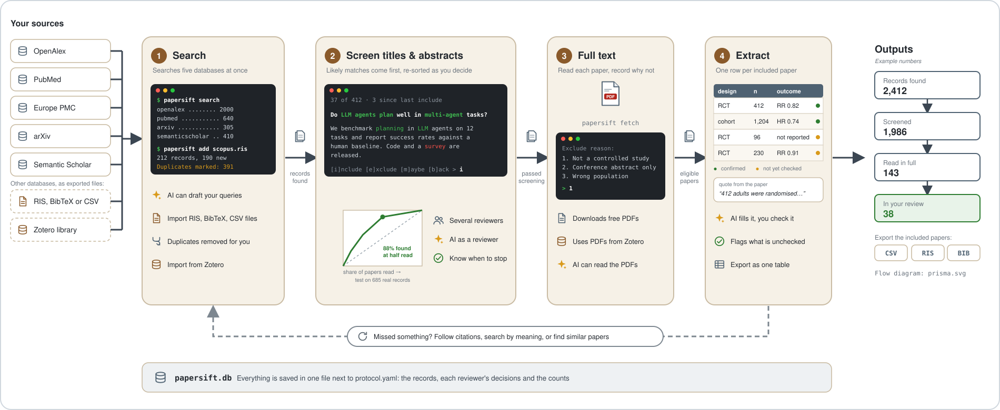
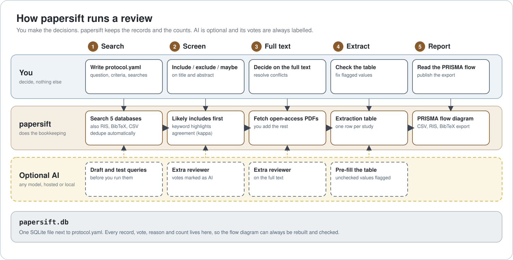

<p align="center"></p>

papersift finds and screens papers for a systematic review and keeps the
counts a PRISMA 2020 flow diagram needs. It searches OpenAlex, PubMed,
Europe PMC, arXiv and Semantic Scholar, reads exports from other databases,
removes duplicates, follows citations, walks you through title/abstract and
full-text screening and data extraction, and writes the flow diagram.

<p align="center"></p>

<p align="center"></p>

<p align="center"></p>

Everything works without AI. With a language model of your choice, hosted
or local, an AI can draft and test your searches, act as an extra reviewer
and pre-fill the extraction table. It also works with Zotero and, through MCP, with AI assistants.

## Install

Needs Python 3.9 or newer.

```
pip install git+https://github.com/Faycall1l/papersift
```

Extras: `papersift[ai]` adds the Anthropic client, `papersift[mcp]` the MCP
server (Python 3.10 or newer), `papersift[ai,mcp]` both. With an extra:

```
pip install "papersift[ai] @ git+https://github.com/Faycall1l/papersift"
```

## A review, start to finish

```
papersift init my-review
cd my-review
```

This creates `protocol.yaml`. Open it in any text editor and write your
question, your inclusion and exclusion criteria, and your searches:

```yaml
title: "Telemonitoring in heart failure"
question: "Does home telemonitoring reduce readmissions in adults with heart failure?"

criteria:
  include:
    - Adults with heart failure
    - Home telemonitoring intervention
    - Reports hospital readmissions
  exclude:
    - Not a controlled study
    - Conference abstract only

years:
  from: 2010
  to: 2025

searches:
  - source: pubmed
    query: '"heart failure"[tiab] AND (telemonitoring[tiab] OR "remote monitoring"[tiab])'
  - source: openalex
    query: '"heart failure" AND (telemonitoring OR "remote monitoring")'
```

Then:

| Step | Command |
| --- | --- |
| Run the searches | `papersift search` |
| Add exports from Scopus, Web of Science, Zotero, etc. | `papersift add export.ris` |
| Screen titles and abstracts | `papersift screen` |
| Download open-access PDFs | `papersift fetch` |
| Screen full texts | `papersift screen --fulltext` |
| Add references and citing papers of the included studies | `papersift chase` |
| Record data from each included study | `papersift extract` |
| See where things stand | `papersift status` |
| Write `prisma.md` and `prisma.svg` | `papersift report` |
| Export the included studies | `papersift export --format csv` (or `ris`, `bib`) |

Duplicates are removed automatically after every search and import: records
with the same DOI or title, and records with the same first author and a
near-identical title or abstract (a preprint and its journal version).
`papersift duplicates` lists what was removed and `--keep ID` restores one.
Screening can be stopped and resumed at any time.

## Screening faster

Once you have included one record and excluded one, `papersift screen`
learns from your decisions and shows the remaining records most likely
relevant first, re-ranking after every decision. The relevant papers come
early, and the header shows how many records you have screened since your
last include, which is the usual signal for when to stop. It runs on your
computer and needs no AI key. `--in-order` turns it off.

To see how well this works for your topic, replay it on records someone has
already screened:

```
papersift simulate ana
```

It reports how many of ana's includes are found after screening 10%, 25% and
50% of the records, and the work saved at 95% recall.

To colour words while screening, list them in `protocol.yaml`:

```yaml
highlight:
  include: [randomised, trial]
  exclude: [mice, protocol]
```

For dual screening, set `reviewers: 2` in `protocol.yaml`. A record's
outcome then counts only once two reviewers have decided it.

## Writing searches

Each database has its own query language.

| Source | Covers | Query syntax |
| --- | --- | --- |
| `openalex` | All fields | `AND`, `OR`, `NOT`, `"exact phrase"`, parentheses. Matches title and abstract. |
| `pubmed` | Biomedicine | The same as on the PubMed website: `term[tiab]`, `"Term"[Mesh]`, etc. |
| `europepmc` | Life sciences, with preprints | As on europepmc.org: `AND`, `OR`, `NOT`, `TITLE:"..."`, `ABSTRACT:"..."`. |
| `arxiv` | Physics, maths, computer science preprints | Field prefixes: `ti:"..."`, `abs:"..."`, joined with `AND`, `OR`, `ANDNOT`. |
| `semanticscholar` | All fields, strong in computer science | `+` for AND, `\|` for OR, `-` for NOT, `"exact phrase"`, parentheses. |

Each search fetches at most 2000 records unless you set `max_results`.

For any other database, export your results as RIS, BibTeX or CSV and use
`papersift add`.

OpenAlex allows a small number of requests per day without a key. For a
large search, get a free key at openalex.org/settings/api and set
`OPENALEX_API_KEY`. `NCBI_API_KEY` is optional and speeds up PubMed.
Semantic Scholar is often rate limited without `S2_API_KEY`.

## Citation chasing

```
papersift chase
```

Looks up each included study in OpenAlex and adds its references and the
papers that cite it. The new records go through screening like any others
and are counted in the flow diagram under `citations`. Run it again after
screening them to go one round further. `--from-abstract` starts from the
records included at the abstract stage instead.

Chasing can return thousands of records. `--min-links 2` keeps only the
papers that cite, or are cited by, at least two of your included studies.

## Checking what the searches missed

Boolean searches miss papers that use other words. Two commands look for
them. Both only list what they find, marking each `have` or `new`; add
`--add` to put the results in the review, where they are screened like any
other record and counted in the flow diagram as their own source.

```
papersift find
papersift find "does remote monitoring keep heart failure patients out of hospital?"
```

`find` searches OpenAlex by meaning rather than by keywords and returns the
50 closest papers. With no argument it uses the question in `protocol.yaml`.
If most results are `have`, your searches cover the topic; a lot of `new`
relevant ones means the queries need more terms.

```
papersift similar
```

`similar` asks Semantic Scholar for papers like the ones you included and
unlike the ones you excluded. It only returns papers from the last few
months, so it is for catching new work and keeping a finished review up to
date.

## Data extraction

List what you want from each study in `protocol.yaml`:

```yaml
extraction:
  - name: design
    question: What was the study design?
    choices: [RCT, cohort, case-control, other]
  - name: sample_size
    question: How many participants were analysed?
```

```
papersift extract
papersift export --extraction
```

`extract` asks each question for each included study. The export is one row
per study and one column per field.

## More than one reviewer

Each person screens under their own name and does not see the others'
decisions:

```
papersift screen --reviewer ana
papersift screen --reviewer ben
papersift agreement ana ben
papersift resolve
```

`agreement` reports percent agreement and Cohen's kappa. `resolve` shows
each record the reviewers disagree on, with their decisions, and records the
final one. A "maybe" always goes to `resolve`.

The review lives in one file, `papersift.db`, next to `protocol.yaml`. Share
the folder to work together; only one person should screen at a time.

## Using AI

Pick the model yourself; there is no default. For a model on the Anthropic
API:

```
pip install "papersift[ai] @ git+https://github.com/Faycall1l/papersift"
export ANTHROPIC_API_KEY=...
export PAPERSIFT_MODEL=<model name>
```

For any server that speaks the OpenAI chat-completions protocol, such as
hosted open models or a local one through Ollama:

```
export PAPERSIFT_API_BASE=http://localhost:11434/v1
export PAPERSIFT_MODEL=gemma3
export PAPERSIFT_API_KEY=...      # if the server needs one
```

These servers get text only: full-text screening of PDFs and `papersift
plan` need the Anthropic API, and extraction falls back to the abstract.
`--model` overrides `PAPERSIFT_MODEL` for one command. A smaller model costs
much less on a large screen. Titles, abstracts and PDFs are sent to
whichever service you choose.

```
papersift plan --known "Title of a paper the search must find" "Another title"
```

`plan` reads your question and criteria, drafts queries, runs them against
the databases to check result counts, reads sample titles, checks that the
papers you named are found, and shows you the final queries before saving
them to `protocol.yaml`.

```
papersift screen --ai
papersift screen --ai --fulltext
```

The AI screens as a reviewer named `ai:<model>`. Its decisions are stored
with a reason and a one-sentence note. It is told to exclude at the abstract
stage only when the abstract leaves no doubt, and to answer "maybe"
otherwise. Full-text screening reads the PDFs downloaded by `papersift fetch`.

```
papersift extract --ai
```

fills in the extraction fields from each PDF, with a supporting quote for
every value. `papersift extract` then shows you each AI value to accept or
correct. Values nobody has checked are listed per study in the export.

The AI is one reviewer, not the final word. Check its work:

```
papersift screen --reviewer ana --show-ai
papersift agreement ana ai:gemma3
```

To measure the AI on records a person has already screened:

```
papersift agreement ai:gemma3 --reference ana
```

This reports recall (how many of ana's includes the AI passed on),
specificity, precision, and which records it missed.

`papersift report` states how many decisions were made by AI with no human
reviewer, so you can report it.

## Zotero

Set `ZOTERO_API_KEY` to a key with write access, from
zotero.org/settings/keys. Add `--group ID` to use a group library.

| To | Run |
| --- | --- |
| Send included studies to a Zotero collection | `papersift zotero push` |
| Send the reports needed at full text | `papersift zotero push --what fulltext` |
| Send the records still to screen | `papersift zotero push --what to-screen` |
| Bring a collection into the review | `papersift zotero pull --collection "Name"` |
| Copy PDFs you have in Zotero into the review | `papersift zotero pdfs` |
| Read screening decisions from Zotero tags | `papersift zotero decisions --collection "Name"` |

To screen inside Zotero, push the records, tag each item `include`,
`exclude` or `maybe`, then run `zotero decisions`. At full text add
`--fulltext` and write the reason in the tag: `exclude: Not a controlled
study`, or `no full text`.

A typical use at full text: push the reports, let Zotero find the PDFs
through your library's access, then `papersift zotero pdfs`.

## AI assistants (MCP)

`papersift mcp` runs an MCP server, so Claude Code, Claude Desktop or any
other MCP client can run the review with you: develop and test searches,
screen, extract and report.

```
claude mcp add papersift -- papersift mcp --project /path/to/my-review
```

For other clients, the command is `papersift` with the arguments `mcp
--project /path/to/my-review`. Decisions made this way are stored under an
`ai:` reviewer name and counted as AI decisions in the report.

## Scripting

Every step also works without prompts, for scripts or coding agents:

```
papersift list --todo --json --limit 20
papersift show 42
papersift decide 42 exclude --reviewer ana --note "animal study"
papersift decide 42 exclude --fulltext --reviewer ana --reason "Not a controlled study"
```

## Limits

- Duplicate detection can miss a preprint whose title, abstract and first
  author all changed on publication.
- Crossref is not a search source because it has no boolean search. Scopus
  and Web of Science need institutional access; export from them and use
  `papersift add`.
- Full texts behind a paywall are not downloaded. Save them yourself as
  `fulltext/<id>.pdf` and run `papersift fetch` again.
- The flow diagram is a single column. Records from citation chasing and
  imported files are counted as their own sources in the first box, not in
  the separate "other methods" column of the full PRISMA 2020 template.

## Development

```
pip install -e ".[dev,ai]"
pytest
```

## References

papersift reports and builds on the following.

- **PRISMA flow diagram:** Page MJ, McKenzie JE, Bossuyt PM, et al. The
  PRISMA 2020 statement: an updated guideline for reporting systematic
  reviews. *BMJ* 2021;372:n71. doi:10.1136/bmj.n71
- **Screening most relevant first:** the idea of learning from your
  decisions and showing likely includes early comes from ASReview. van de
  Schoot R, de Bruin J, Schram R, et al. An open source machine learning
  framework for efficient and transparent systematic reviews. *Nature
  Machine Intelligence* 2021;3:125-133. doi:10.1038/s42256-020-00287-7
- **Work saved at 95% recall (`simulate`):** Cohen AM, Hersh WR, Peterson K,
  Yen PY. Reducing workload in systematic review preparation using
  automated citation classification. *J Am Med Inform Assoc*
  2006;13:206-219. doi:10.1197/jamia.M1929
- **Keyword highlighting:** Ouzzani M, Hammady H, Fedorowicz Z, Elmagarmid
  A. Rayyan: a web and mobile app for systematic reviews. *Systematic
  Reviews* 2016;5:210. doi:10.1186/s13643-016-0384-4
- **Citation chasing:** Wohlin C. Guidelines for snowballing in systematic
  literature studies and a replication in software engineering. *EASE '14*,
  2014:1-10. doi:10.1145/2601248.2601268
- **Agreement between reviewers:** Cohen J. A coefficient of agreement for
  nominal scales. *Educational and Psychological Measurement*
  1960;20:37-46. doi:10.1177/001316446002000104
- **Search by meaning and citation data:** Priem J, Piwowar H, Orr R.
  OpenAlex: a fully-open index of scholarly works, authors, venues,
  institutions, and concepts. arXiv:2205.01833, 2022.
- **Europe PMC:** The Europe PMC Consortium. Europe PMC: a full-text
  literature database for the life sciences and platform for innovation.
  *Nucleic Acids Research* 2015;43:D1042-D1048. doi:10.1093/nar/gku1061

Requiring two reviewers is modelled on Covidence (covidence.org).

Apache License 2.0.
